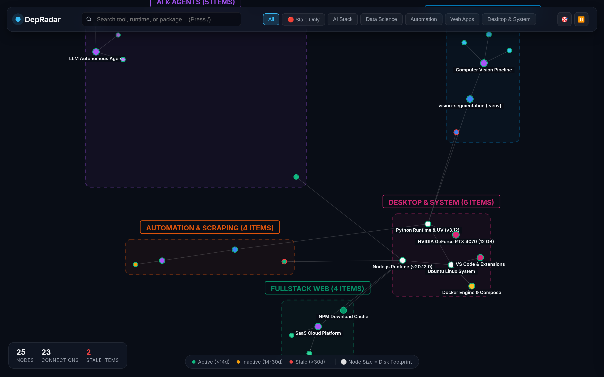
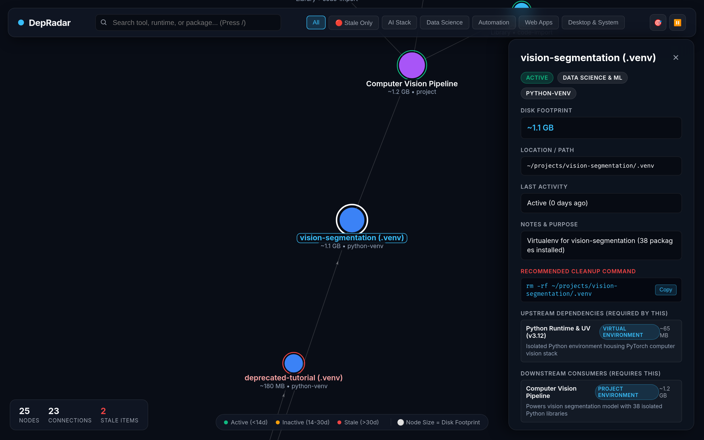
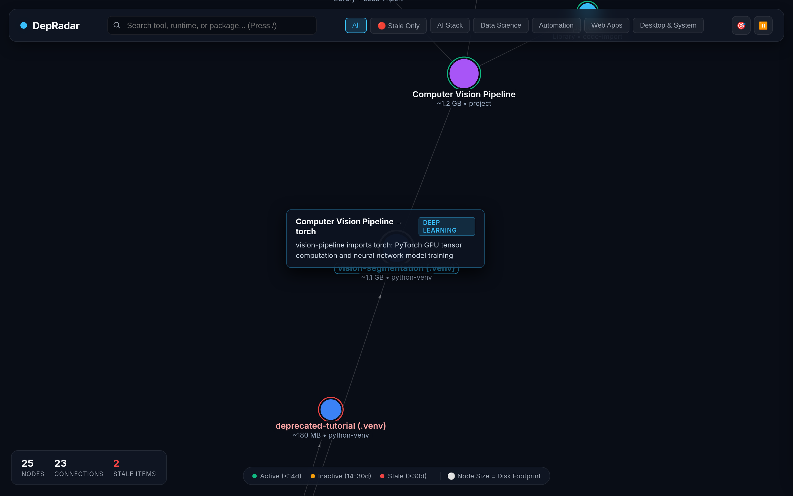

# 📡 DepRadar

> **Interactive System & Package Dependency Radar**  
> Turn your developer environment into a force-directed visual network map. Discover forgotten packages, identify heavyweight runtimes, and track stale experiments.

[](https://pypi.org/project/depradar/)
[](https://pypi.org/project/depradar/)
[](https://github.com/mdphd97/depradar/releases)
[](https://github.com/mdphd97/depradar/actions/workflows/ci.yml)
[](https://python.org)
[](LICENSE)
[](https://mdphd97.github.io/depradar/)
[](#)
[](#)
[](#)

---

## 🌟 Overview

When building AI workflows, running web scraping experiments, and testing new libraries, workstations accumulate dozens of virtualenvs, global NPM packages, container runtimes, and background daemons. **DepRadar** scans your machine and generates an interactive, force-directed dependency graph that makes storage footprints and relationships crystal clear.

---

## 📸 Screenshots & Showcase

### 1. Force-Directed Constellation View
*Explore runtime engines, container daemons, virtual environments, and developer suites grouped cleanly into outer macro-clusters.*


### 2. Deep Inspector Drawer & 1-Click Cleanup
*Click any node to smoothly fly in, inspect upstream runtime requirements, downstream dependent projects, full package manifests with versions, and grab clipboard-ready deletion commands.*


### 3. Link Hover & Relationship Explanations
*Hover over any connection to reveal the exact nature of the dependency and how your tools interact under the hood.*


---

## ✨ Features

- 🌐 **Force-Directed Physics Graph**: Smooth 60fps canvas visualizer powered by D3/Force-Graph with drag, zoom, and perimeter macro-clustering.
- 📦 **Multi-Ecosystem Cartography**:
  - **Python**: Scans virtual environments (`.venv`), `uv` tools, and active package dependencies.
  - **Node.js**: Maps global NPM CLI utilities and local project engines.
  - **Desktop & Snaps**: Identifies containerized Snap applications and heavy compatibility layers (e.g., Wine runtimes).
  - **APT & Developer Suites**: Maps Docker daemons, XeLaTeX suites, and native packages.
  - **Standalone Tools**: Detects unmanaged toolkits like IBM CPLEX and desktop Electron runtimes.
- ⚖️ **Proportional Disk Sizing**: Node radius scales dynamically with storage consumption—heavy 1.5 GB+ runtimes immediately stand out.
- 🚦 **Freshness & Stale Detection**:
  - 🟢 **Active**: Used within 14 days.
  - 🟡 **Inactive**: 14–30 days idle.
  - 🔴 **Stale**: 30+ days untouched (candidates for deletion).
- 🔍 **Instant Search & Category Filtering**: Hotkey `/` for rapid search, plus one-click filters for AI Stack, Data Science, Snaps, and Stale Items.
- 🛠️ **Deep Inspector & 1-Click Cleanup**: Slide-out drawer displaying upstream requirements, downstream dependents, file paths, and clipboard-ready uninstall commands.
- ⚡ **Zero-Dependency Portable Output**: Emits a single self-contained `.html` file that can be opened in any modern browser without running a server.
- 💻 **Cross-Platform (Linux, macOS, Windows)**:
  - **Linux**: APT packages, Snap daemons, Flatpak, Docker, NVIDIA GPU.
  - **macOS**: Homebrew formulae/casks, `/Applications`, Apple Metal GPU acceleration.
  - **Windows**: Winget, Scoop, Chocolatey, `%LOCALAPPDATA%`, Windows Terminal, WSL.
- 🤖 **AI-Agent Ready & MCP Native**:
  - **MCP Server (`depradar mcp`)**: Plug DepRadar directly into Claude Desktop, Cursor, Windsurf, or Antigravity via Model Context Protocol.
  - **Fast Query Engine (`depradar query <pkg> --json`)**: Instant CLI dependency and usage lookup for AI agents.
  - **Stale Pruning (`depradar stale --json`)**: Programmatic cleanup automation for autonomous agents.
  - **Agent Context Generator (`depradar agent-context`)**: Emits compact, token-efficient system context briefings for LLM prompts.

---

## 🚀 Quick Start

### Installation & Instant Run

#### 1. Instant Run (Zero Permanent Installation via `uv`)
The fastest way to run DepRadar without altering your local packages:
```bash
uvx depradar
```

#### 2. Install Globally via `uv` or `pip`
```bash
# Isolated CLI tool via uv (recommended)
uv tool install depradar

# Standard installation via pip
pip install depradar
```

<details>
<summary>🛠️ Local Development Installation</summary>

```bash
# Clone the repository
git clone https://github.com/mdphd97/depradar.git
cd depradar

# Install in editable mode
pip install -e .
```
</details>

---

### Usage & Command Suite

```bash
# 1. Scan your system and automatically launch the interactive graph in your browser
depradar

# 2. Run the interactive local daemon with real-time API endpoints
depradar serve --port 8080

# 3. Time-Machine Snapshots & Environment Drift Diffing
depradar snapshot --save --label "pre-upgrade"  # Save baseline snapshot
depradar snapshot --list                         # List all captured snapshots
depradar diff --since latest                     # Inspect package upgrades, removals & storage deltas

# 4. Security & Vulnerability Auditing
depradar audit                                  # Fast offline CVE and advisory audit
depradar audit --online                         # Query OSV database for latest advisories

# 5. Export graph data as raw JSON for custom analysis
depradar export -o graph_data.json
```

---

## 🤖 AI Agent & MCP Server Integration

DepRadar natively integrates with AI coding assistants (Claude Desktop, Cursor, Antigravity, Windsurf, Aider):

### 1. Model Context Protocol (MCP) Server
Add DepRadar to your `claude_desktop_config.json` or `.cursor/mcp.json`:
```json
{
  "mcpServers": {
    "depradar": {
      "command": "depradar",
      "args": ["mcp"]
    }
  }
}
```

#### Available MCP Tools (7 Native Tools):
* `depradar_get_system_overview`: High-level inventory of runtimes, disk sizes, and OS info.
* `depradar_query_dependency`: Inquires which projects import a library and which runtime powers it.
* `depradar_list_stale_dependencies`: Surfaces unreferenced or idle packages with cleanup commands.
* `depradar_get_full_graph`: Emits complete dependency graph.
* `depradar_audit_vulnerabilities`: Audits installed environment packages for known CVEs.
* `depradar_save_snapshot`: Captures a baseline checkpoint before executing complex coding tasks.
* `depradar_get_environment_diff`: Reports environment drift and temporary packages created by agents.

### 2. CLI for AI Subagents & Automation Scripts
```bash
# Query any dependency in JSON
depradar query selenium --json

# List stale items and cleanup commands for automated maintenance
depradar stale --json

# Diff environment against a previous baseline
depradar diff --since latest --json

# Generate an LLM-optimized Markdown briefing for system prompts / CLAUDE.md
depradar agent-context
```

---

## 🗺️ How DepRadar Maps Dependencies

```
[ Ubuntu APT / Homebrew / Winget ] ──► [ Developer Suites ] ──┐
                                                              ▼
[ Node.js Runtime (v20) ] ──────────► [ Fullstack Web Apps ] ─┘
         │
         ├──────────────────────────► [ agent-browser CLI ]
         │
         └──────────────────────────► [ firecrawl-cli ]

[ Snap / App Sandbox ] ─────────────► [ Wine Runtimes (~1.5GB) ] ─► [ Standalone Apps ]
```

---

## ⌨️ Shortcuts & Viewer Controls

| Key / Action | Action |
| :--- | :--- |
| **`/`** | Focus search bar |
| **`Esc`** | Close node inspector drawer |
| **Click Node** | Smoothly zoom in & open inspector |
| **Click Background** | Close drawer |
| **`🎯` (Center)** | Fit graph to viewport |
| **`⏸️` / `▶️`** | Freeze / resume physics simulation |

---

## 💻 Supported Environments

| Platform | Package Managers & Runtimes Detected | Hardware Acceleration |
| :--- | :--- | :--- |
| **Linux** | APT, Snap, Flatpak, Docker, UV Tools, Global NPM | NVIDIA CUDA / GeForce |
| **macOS** | Homebrew (Formulae & Casks), `/Applications`, Pipx, UV Tools | Apple Silicon Metal GPU |
| **Windows** | Winget, Scoop, Chocolatey, PowerShell, WSL2, LocalAppData | Direct3D / Vulkan |

---

## 🤝 Contributing

Contributions are welcome! If you want to add scanners for additional package managers, container runtimes, or custom desktop suites, feel free to submit a pull request or open an issue.

1. Fork the Project
2. Create your Feature Branch (`git checkout -b feat/new-scanner`)
3. Commit your Changes (`git commit -m 'feat: add podman container scanner'`)
4. Push to the Branch (`git push origin feat/new-scanner`)
5. Open a Pull Request

---

## 📄 License

Distributed under the **MIT License**. See [`LICENSE`](LICENSE) for details.
